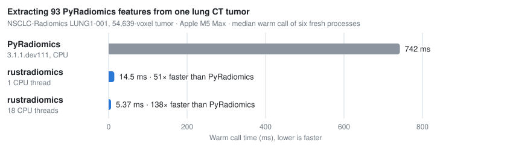

<div align="center">

# rustradiomics

Radiomics feature extraction in Rust, with a Python API. Computes PyRadiomics and IBSI
features of a segmented region, or a map of each feature over the image. The standard
PyRadiomics features run 50 to 140 times faster than in PyRadiomics.

[](#install)
[](#rust)
[](https://github.com/Alfredo-Sandoval/rust-radiomics/blob/main/LICENSE)
[](#install)

[Getting started](https://github.com/Alfredo-Sandoval/rust-radiomics/blob/main/docs/guide/getting-started.md) · [Python API](https://github.com/Alfredo-Sandoval/rust-radiomics/blob/main/docs/guide/python-api.md) · [Rust API](https://github.com/Alfredo-Sandoval/rust-radiomics/blob/main/docs/guide/rust-api.md) · [Feature catalog](https://github.com/Alfredo-Sandoval/rust-radiomics/blob/main/docs/guide/features.md) · [Parameters](https://github.com/Alfredo-Sandoval/rust-radiomics/blob/main/docs/guide/parameters.md)

<picture>
  <source media="(prefers-color-scheme: dark)" srcset="docs/assets/phantom-dark.svg">
  
</picture>

<sub>The <a href="https://ibsi.readthedocs.io/en/latest/05_Reference_data_sets.html#digital-phantom">IBSI digital phantom</a> by Alex Zwanenburg (CC BY 4.0) and its GLCM joint entropy map. Each cube is one voxel, and the mask covers the 74 gray voxels.</sub>

</div>

| Input | Output |
| :--- | :--- |
| Aligned image + integer label mask · NumPy arrays, NIfTI or NRRD | ROI features, or one voxel map per feature in memory or as float32 NIfTI |

rustradiomics uses PyRadiomics feature names, reads PyRadiomics parameter files and
follows IBSI definitions by default. It computes in float64 on the CPU.

## Install

```bash
uv venv --python 3.13
source .venv/bin/activate
RELEASE=https://github.com/Alfredo-Sandoval/rust-radiomics/releases/download/v1.1.0
uv pip install "$RELEASE/rustradiomics-1.1.0-cp313-cp313-macosx_11_0_arm64.whl"
```

The [1.1.0 release](https://github.com/Alfredo-Sandoval/rust-radiomics/releases/tag/v1.1.0)
has wheels for Apple silicon Macs with Python 3.13, 3.14 and 3.15. For another Python
version, change `3.13` and both `cp313` tags, such as to `3.14` and `cp314`. To build from
a checkout with Rust 1.96.0 installed, run
`RUSTUP_TOOLCHAIN=1.96.0 uv pip install ./crates/radiomics-py` from the repository root.
Before 1.1.0 the package was named `rustrad`.

## Run

```python
from rustradiomics import Settings, extract_files

phantom = "crates/radiomics/tests/data/w12/digital_phantom_"
result = extract_files(
    phantom + "image.nii.gz", phantom + "mask.nii.gz",
    settings=Settings(label=1, features=("firstorder_Mean", "shape_VoxelVolume")),
)
print(result.features)
```

```text
{'original_firstorder_Mean': 2.148648738861084, 'original_shape_VoxelVolume': 592.0}
```

The image and mask are the phantom above, included in this repository. Run the example
from the repository root, or pass your own NIfTI or NRRD image and mask.

| Operation | Arrays | NIfTI/NRRD files | Returns |
| :--- | :--- | :--- | :--- |
| ROI features | `extract` | `extract_files` | `Result` of floats |
| Voxel maps in memory | `extract(..., mode="voxel")` | `extract_files(..., mode="voxel")` | `Result` of NumPy arrays |
| Voxel maps on disk | `export` | `export_files` | `MapExport` with the map paths |

Options are keyword-only:

| Option | Sets |
| :--- | :--- |
| `settings=` | Label, features, binning and conventions (`Settings`) |
| `transforms=` | Derived images such as wavelet or LoG (`TransformSettings`) |
| `image_settings=` | Resampling and mask correction for file inputs (`ImageSettings`) |
| `spacing=` | Array voxel sizes in millimeters, in NumPy axis order |
| `map_dtype=` | `"float64"` (default) or `"float32"` for maps kept in memory |

- **Label:** `Settings(label=...)` selects one structure in a multi-label mask. The default is 1.
- **Geometry:** file operations read spacing from the image. Array extraction assumes 1 mm
  on each axis and warns when `spacing` is omitted.
- **Maps:** map values have float32 precision. Exports and streamed batches are float32.
  Read saved maps with NiBabel, because SimpleITK reads NaN voxels as zero.
- **Undefined values:** NaN. Overflow gives infinity.
- **Errors:** unsupported options and invalid inputs raise `InvalidInputError`.
- **Threads:** set `RAYON_NUM_THREADS` to limit the CPU threads used.

### Voxel maps

This call writes the joint entropy map shown above as a NIfTI file.

```python
from rustradiomics import Settings, export_files

phantom = "crates/radiomics/tests/data/w12/digital_phantom_"
saved = export_files(
    phantom + "image.nii.gz", phantom + "mask.nii.gz", "outputs/phantom",
    settings=Settings(label=1, features=("glcm_JointEntropy",), bin_width=1, kernel_radius=1),
)
saved.maps["original_glcm_JointEntropy"]  # pathlib.Path to a float32 NIfTI
saved.report                              # pathlib.Path to features.json
```

The [Python guide](https://github.com/Alfredo-Sandoval/rust-radiomics/blob/main/docs/guide/python-api.md) covers settings, streaming voxel batches
and errors.

## Features

`rustradiomics.FEATURES` lists 200 names, including all 116 non-deprecated PyRadiomics
features. Without a `features` selection, extraction returns the 93 PyRadiomics intensity
and texture features. Request shape and the other families by name, or select whole
families with `list_features("firstorder", "glcm")`.

The `intensityhistogram`, `gldzm`, `ivh` and `localintensity` families come from IBSI and
are not in PyRadiomics. The `momentinvariant` features follow the PySERA definitions.

| Family | Count | Modes |
| --- | ---: | --- |
| `firstorder` | 21 | ROI, voxel |
| `intensityhistogram` | 23 | ROI, voxel |
| `glcm` | 26 | ROI, voxel |
| `gldm` (NGLDM) | 17 | ROI, voxel |
| `ngtdm` | 5 | ROI, voxel |
| `glrlm` | 16 | ROI, voxel |
| `glszm` | 16 | ROI, voxel |
| `gldzm` | 16 | ROI, voxel |
| `ivh` | 7 | ROI, voxel |
| `localintensity` | 2 | 3D ROI |
| `shape` | 32 | 3D ROI |
| `momentinvariant` | 10 | 3D ROI |
| `shape2D` | 9 | 2D ROI, or one slice of a 3D ROI |

The [feature catalog](https://github.com/Alfredo-Sandoval/rust-radiomics/blob/main/docs/guide/features.md) gives the units and IBSI identifier of
each feature.

## Parameter files

`load_params` reads the `setting`, `imageType` and `featureClass` sections of a PyRadiomics
parameter file. Unsupported keys raise `InvalidInputError`.

```yaml
setting:
  binWidth: 1
  label: 1
imageType:
  Original: {}
  Wavelet:
    level: 1
featureClass:
  firstorder: [Mean, Entropy]
  glcm: [Contrast, JointEntropy]
```

```python
from rustradiomics import extract_files
from rustradiomics.config.parameters import load_params, parse_params

phantom = "crates/radiomics/tests/data/w12/digital_phantom_"
params = parse_params(load_params("params.yaml"), ndim=3)
result = extract_files(
    phantom + "image.nii.gz", phantom + "mask.nii.gz",
    settings=params.settings,
    image_settings=params.image_settings,
    transforms=params.transforms,
)
result.features["wavelet-LLH_glcm_Contrast"]
```

`imageType` accepts `Original`, `Square`, `SquareRoot`, `Logarithm`, `Exponential`,
`Gradient`, `Wavelet`, `LoG`, `LBP2D`, `LBP3D`, `Mean`, `Laws`, `Gabor`, `SeparableWavelet`,
`Simoncelli` and `Riesz`. See [parameters](https://github.com/Alfredo-Sandoval/rust-radiomics/blob/main/docs/guide/parameters.md) for filter options and convention settings.

## Rust

```toml
[dependencies]
radiomics = { git = "https://github.com/Alfredo-Sandoval/rust-radiomics", tag = "v1.1.0" }
```

```rust
use std::path::Path;
use radiomics::{FeatureValue, Output, Settings, extract_files};

fn main() -> radiomics::Result<()> {
    let phantom = Path::new("crates/radiomics/tests/data/w12");
    let settings = Settings {
        features: vec!["firstorder_Mean".into()],
        ..Settings::default()
    };
    let result = extract_files(
        &phantom.join("digital_phantom_image.nii.gz"),
        &phantom.join("digital_phantom_mask.nii.gz"),
        &settings,
        &Default::default(),
        &Default::default(),
        Output::Roi,
    )?;
    if let FeatureValue::Scalar(mean) = &result.features["original_firstorder_Mean"] {
        println!("Mean intensity: {mean:.2}");
    }
    Ok(())
}
```

The crate also takes `ndarray` arrays, streams voxel maps in batches and writes them to
disk. See the [Rust API](https://github.com/Alfredo-Sandoval/rust-radiomics/blob/main/docs/guide/rust-api.md).

## Performance

<picture>
  <source media="(prefers-color-scheme: dark)" srcset="docs/assets/speed-dark.svg">
  
</picture>

rustradiomics and PyRadiomics computed the same 93 intensity and texture features from the
same arrays of the NSCLC-Radiomics LUNG1-001 CT (512 × 512 × 134 voxels, tumor mask of
54,639 voxels), with rustradiomics set to PyRadiomics conventions. All 93 values agreed
within a relative tolerance of 1e-6. Times are medians of six fresh processes on an Apple
M5 Max, with file reading excluded. A warm call is one made after the first call in the
process. rustradiomics was measured with the 1.0.0 wheel, published as `rustrad`.

| Implementation | Warm call | First call | Warm speedup |
| :--- | ---: | ---: | ---: |
| PyRadiomics 3.1.1.dev111 | 742 ms | 796 ms | 1× |
| rustradiomics, 1 thread | 14.5 ms | 32.2 ms | 51× |
| rustradiomics, 18 threads | 5.37 ms | 23.9 ms | 138× |

PyRadiomics added 306 MB to the peak process footprint, and rustradiomics added 12 MB with
one thread and 30 MB with 18. The [performance notes](https://github.com/Alfredo-Sandoval/rust-radiomics/blob/main/docs/performance.md)
give the method and commands, a comparison with mlx-radiomics on Metal and the voxel map
timings. `python3 docs/assets/speed.py` redraws the figure from
[`benchmarks/results/pyradiomics.json`](https://github.com/Alfredo-Sandoval/rust-radiomics/blob/main/benchmarks/results/pyradiomics.json).

## Validation

| Reference | Result |
| :--- | :--- |
| IBSI 1 digital phantom | All 482 results with published reference values pass |
| IBSI 1 CT phantom, configurations A–E | 1,321 of 1,322 results within the published tolerance; the other matches at three significant digits |
| IBSI 2 filter responses | All 33 maps within 1% of the reference map's intensity range |
| IBSI 2 CT features | All 323 consensus values within their published tolerances |
| 1 and 18 threads on one CT scan | Identical ROI features and voxel maps |

See the [technical notes](https://github.com/Alfredo-Sandoval/rust-radiomics/blob/main/docs/technical.md) for methods, and
[limits](https://github.com/Alfredo-Sandoval/rust-radiomics/blob/main/docs/guide/limits.md) for input requirements.

## License

[Apache-2.0](https://github.com/Alfredo-Sandoval/rust-radiomics/blob/main/LICENSE). See [third-party notices](https://github.com/Alfredo-Sandoval/rust-radiomics/blob/main/THIRD_PARTY_NOTICES.md), including CC BY 4.0 attribution for the IBSI definitions.
