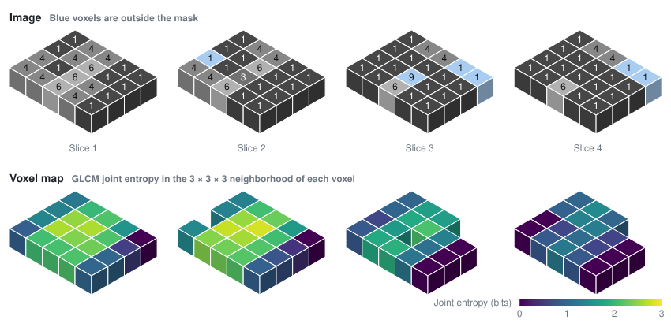

<div align="center">

# rust radiomics

Extract radiomics features and voxel maps on the CPU with native Rust,
50 to 140 times faster than PyRadiomics.

[](#install)
[](#rust)
[](https://github.com/Alfredo-Sandoval/rust-radiomics/blob/main/LICENSE)
[](#install)

[Getting started](https://github.com/Alfredo-Sandoval/rust-radiomics/blob/main/docs/guide/getting-started.md) · [Python API](https://github.com/Alfredo-Sandoval/rust-radiomics/blob/main/docs/guide/python-api.md) · [Rust API](https://github.com/Alfredo-Sandoval/rust-radiomics/blob/main/docs/guide/rust-api.md) · [Feature catalog](https://github.com/Alfredo-Sandoval/rust-radiomics/blob/main/docs/guide/features.md) · [Performance](https://github.com/Alfredo-Sandoval/rust-radiomics/blob/main/docs/performance.md)

<picture>
  <source media="(prefers-color-scheme: dark)" srcset="https://raw.githubusercontent.com/Alfredo-Sandoval/rust-radiomics/main/docs/assets/phantom-dark.svg">
  
</picture>

<sub>The <a href="https://ibsi.readthedocs.io/en/latest/05_Reference_data_sets.html#digital-phantom">IBSI digital phantom</a> by Alex Zwanenburg (CC BY 4.0) and its GLCM joint entropy map.</sub>

</div>

| Input | Output |
| :--- | :--- |
| Aligned image + integer label mask | ROI features, or one voxel map per feature in memory or as float32 NIfTI |

<picture>
  <source media="(prefers-color-scheme: dark)" srcset="https://raw.githubusercontent.com/Alfredo-Sandoval/rust-radiomics/main/docs/assets/speed-dark.svg">
  
</picture>

PyRadiomics feature names and parameter files, with configurable IBSI conventions. With
PyRadiomics conventions selected, the 93 values agree with PyRadiomics within a relative
1e-6. All IBSI 1 digital phantom values and IBSI 2 consensus values pass
([validation](https://github.com/Alfredo-Sandoval/rust-radiomics/blob/main/docs/technical.md#validation)). The only dependency is NumPy.

On an Apple silicon Mac, see also [mlx-radiomics](https://github.com/MedMLX/mlx-radiomics),
which runs on the GPU and is listed among the
[IBSI implementations](https://theibsi.github.io/implementations).

## Install

```sh
pip install rustradiomics
```

Needs Python 3.13, 3.14 or 3.15. PyPI has wheels for Apple silicon Macs. On other
systems pip builds from source, which needs a Rust toolchain.

## Python API

Start with image and mask files to preserve their physical geometry. Arrays use the
same settings and result contract:

```python
from rustradiomics import Settings, extract_files

settings = Settings(
    label=1, bin_width=25,
    features=("firstorder_Mean", "glcm_Contrast"),
)
result = extract_files(
    "image.nii.gz", "mask.nii.gz", settings=settings,
)
mean = result.features["original_firstorder_Mean"]
```

Add `mode="voxel"` for maps in memory. Use `export_files` to write voxel maps
without retaining every map in memory. `export` and `export_files` always write
voxel maps. For ROI values, use `result.features`.

**Conventions:** defaults follow IBSI, even when using PyRadiomics feature names
or parameter files. Select alternative definitions through individual `Settings`
fields.

### Arrays and maps

```python
from rustradiomics import extract, extract_files, export_files

roi = extract(image, mask, spacing=(3.0, 1.0, 1.0), settings=settings)
roi.features["original_firstorder_Mean"]    # float

voxel = extract_files(
    "image.nii.gz", "mask.nii.gz", settings=settings, mode="voxel",
)
voxel.features["original_firstorder_Mean"]  # float64 NumPy array

saved = export_files(
    "image.nii.gz", "mask.nii.gz", "outputs/maps", settings=settings,
)
saved.report                            # path to features.json
saved.maps["original_firstorder_Mean"]  # path to a float32 NIfTI
saved.metadata["settings"]              # effective settings
```

| Operation | Arrays | NIfTI/NRRD files | Result |
| --- | --- | --- | --- |
| ROI features | `extract(image, mask)` | `extract_files(image_path, mask_path)` | `Result[float]` |
| Voxel maps in memory | `extract(image, mask, mode="voxel")` | `extract_files(image_path, mask_path, mode="voxel")` | `Result[NDArray[np.float64]]` |
| Voxel maps on disk | `export(image, mask, output_dir)` | `export_files(image_path, mask_path, output_dir)` | `MapExport(report, maps, metadata)` |

Options are keyword-only:

| Option | Sets |
| :--- | :--- |
| `settings=` | Features and binning |
| `transforms=` | Derived images |
| `image_settings=` | Resampling and mask correction for file inputs |
| `spacing=` | Array voxel sizes in NumPy axis order |

- **Geometry:** file operations read geometry from the image. Array extraction warns
  when `spacing` is omitted and assumes 1 mm on each axis. Array `export` writes zero
  origin and identity direction; use file operations for scanner-aligned output, or
  explicitly acknowledge synthetic coordinates with `allow_synthetic_geometry=True`.
- **Precision:** feature arithmetic is float64. First-order statistics and the
  intensity peaks are returned as float32 values. In-memory float64 maps hold float32
  samples; pass `map_dtype="float32"` to `extract` or `extract_files` to halve
  retained map storage. Saved maps and streamed batches are float32.

Extraction results expose `.features` and `.metadata`; exports expose `.report`,
`.maps` and `.metadata`. The [Python guide](https://github.com/Alfredo-Sandoval/rust-radiomics/blob/main/docs/guide/python-api.md)
covers settings, streaming voxel batches and errors.

## Parameter files

The supported PyRadiomics sections are `setting`, `imageType` and `featureClass`.
Unsupported keys, image types and per-image overrides raise `InvalidInputError`.

```yaml
setting:
  binWidth: 25
  label: 1
  resampledPixelSpacing: [1.0, 1.0, 1.0]
  interpolator: sitkLinear
  padDistance: 1
imageType:
  Original: {}
  Wavelet:
    level: 1
featureClass:
  firstorder: [Mean, Entropy]
  glcm: [Contrast, JointEntropy]
```

| `imageType` keys | Status |
| :--- | :--- |
| `Original`, `Square`, `SquareRoot`, `Logarithm`, `Exponential`, `Gradient`, `Wavelet`, `LoG`, `LBP2D`, `LBP3D`, `Mean`, `Laws`, `Gabor`, `SeparableWavelet`, `Simoncelli` (alias `NonseparableWavelet`), `Riesz` | Supported |

See [parameter files](https://github.com/Alfredo-Sandoval/rust-radiomics/blob/main/docs/guide/parameters.md) for loading a file and filter options, and
[conventions](https://github.com/Alfredo-Sandoval/rust-radiomics/blob/main/docs/guide/parameters.md#conventions) for definition settings.

## Features

Use `list_features("firstorder", "glcm")` to select whole families, or
`list_features(mode="voxel", ndim=3)` to discover names supported in that mode.
Pass its result as `Settings(features=...)`. Selecting a family does not change
binning or numerical conventions.

`rustradiomics.FEATURES` lists all 200 names, including all 116 non-deprecated
PyRadiomics features. Without a `features` selection, extraction returns the 93
PyRadiomics intensity and texture features; request shape and the other families
by name.

| Family | Count | Modes |
| --- | ---: | --- |
| `firstorder` | 21 | ROI, voxel |
| `intensityhistogram` | 23 | ROI, voxel |
| `glcm` | 26 | ROI, voxel |
| `gldm` (NGLDM) | 17 | ROI, voxel |
| `ngtdm` | 5 | ROI, voxel |
| `glrlm` | 16 | ROI, voxel |
| `glszm` | 16 | ROI, voxel |
| `gldzm` | 16 | ROI, voxel |
| `ivh` | 7 | ROI, voxel |
| `localintensity` | 2 | 3D ROI |
| `shape` | 32 | 3D ROI |
| `momentinvariant` | 10 | 3D ROI |
| `shape2D` | 9 | 2D ROI, or one slice of a 3D ROI |

Calculation conventions such as kurtosis, shape covariance divisor, NGTDM
singular cases and fixed-bin-size origin are independent `Settings` fields with
IBSI defaults. Select each alternative explicitly; see
[Conventions](https://github.com/Alfredo-Sandoval/rust-radiomics/blob/main/docs/guide/parameters.md#conventions).
The [feature catalog](https://github.com/Alfredo-Sandoval/rust-radiomics/blob/main/docs/guide/features.md#catalog) lists public names and
their IBSI identifiers.

## Rust

The `radiomics` crate is the engine behind the Python package and has the same four
operations.

```toml
[dependencies]
radiomics = { git = "https://github.com/Alfredo-Sandoval/rust-radiomics" }
```

See the [Rust API](https://github.com/Alfredo-Sandoval/rust-radiomics/blob/main/docs/guide/rust-api.md).

## Limits

- Shape, local intensity and moment invariants are ROI-only; local intensity and moment
  invariants need 3D input.
- Undefined values are NaN; overflow is infinity.
- Read voxel maps with NiBabel; SimpleITK reads stored NaN voxels as zero.
- Detached inputs such as `.nhdr` require a new output directory, even with
  `overwrite=True`.
- The MedMLX runner and the `viz` module of mlx-radiomics are not ported.

See [limits](https://github.com/Alfredo-Sandoval/rust-radiomics/blob/main/docs/guide/limits.md)
for filter requirements, supported inputs and the differences from mlx-radiomics.

## License

[Apache-2.0](https://github.com/Alfredo-Sandoval/rust-radiomics/blob/main/LICENSE). See [third-party notices](https://github.com/Alfredo-Sandoval/rust-radiomics/blob/main/THIRD_PARTY_NOTICES.md), including CC BY 4.0 attribution
for the IBSI definitions.
